# Пятимирье

Аркада на время: собери все предметы, не попадись врагам и ловушкам, добеги до выхода.
Главное в игре соревнование: таблицы рекордов на каждом уровне, призрак лучшего забега,
который бежит рядом с тобой, испытание дня с одинаковым для всех уровнем и дуэль вдвоём
на одном экране.

Пять миров, у каждого свой герой, способность, враги и ловушки: **Кристальная шахта**,
**Осенний лес**, **Ночной храм**, **Руины передовой** и **Открытый космос**.

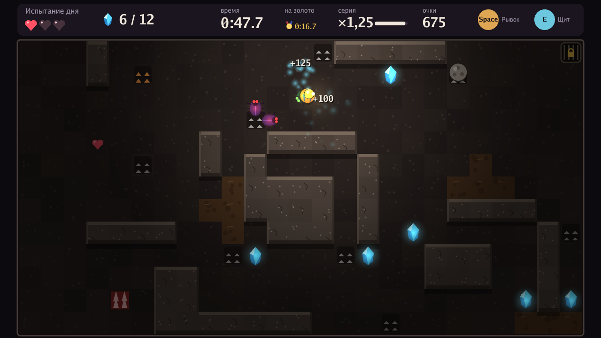

| Меню | Итоги уровня |
|---|---|
|  |  |

**Платформы:** Windows, Linux, macOS, Android, iOS и браузер (WebAssembly).

## Как играть

| Действие | Клавиатура | Геймпад |
|---|---|---|
| Движение | WASD / стрелки | левый стик / крестовина |
| Рывок (неуязвим на время рывка) | Space / Shift | A / RB |
| Способность героя (своя в каждом мире) | E / Q | X / LB |
| Пауза | Esc / P | Start |
| Мгновенный рестарт | R | Y |
| Сменить мир (в выборе уровня и рекордах) | Q / E, PgUp / PgDn | LB / RB |
| Полный экран | F11 / Alt+Enter | |
| Звук | M | |
| Автопилот (демонстрация, F9) | F9 | |

Клавиши движения, рывка и способности можно переназначить в **Настройки → Клавиши**,
отдельно для одиночной игры и для каждого игрока дуэли (по две клавиши на действие).
Если назначить клавишу, которая уже занята, она снимается со старого действия, а в дуэли
одна клавиша не может достаться обоим игрокам. Там же громкость, отключение тряски
экрана и вспышек (для тех, кому они мешают), призрак соперника и полный экран.

| Настройки | Переназначение клавиш |
|---|---|
| 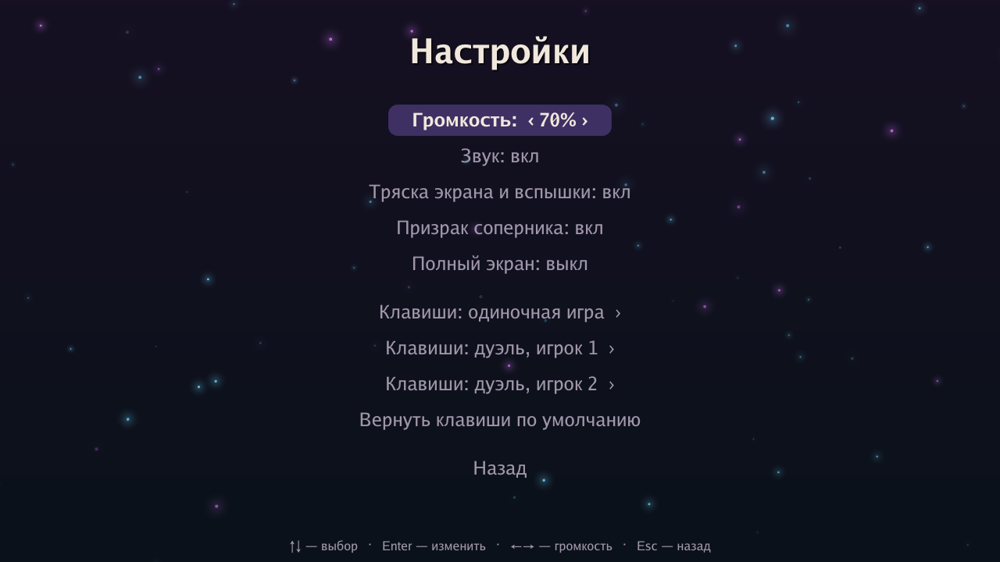 | 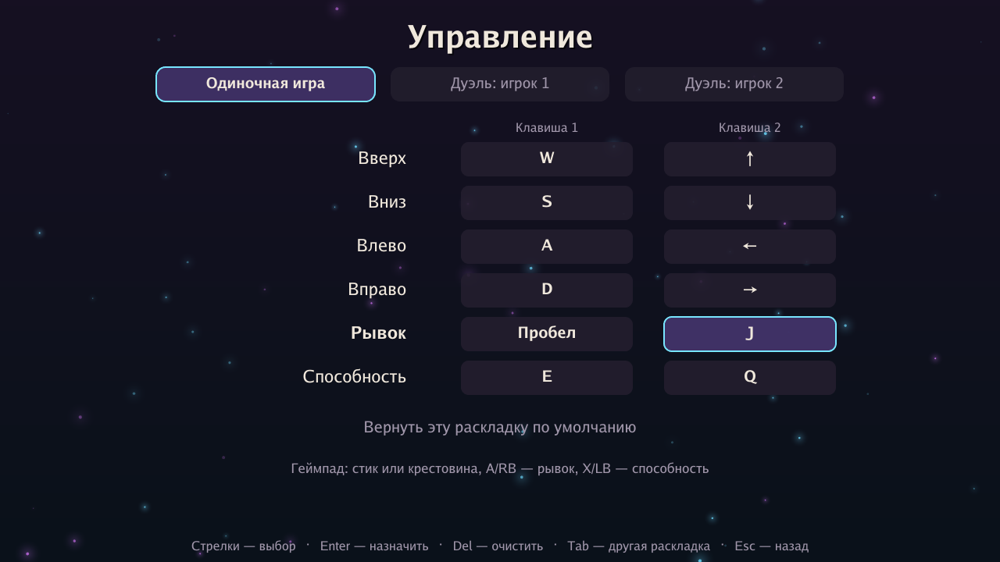 |

**На телефоне** управление сенсорное: левая половина экрана — плавающий джойстик
(касаешься где угодно и ведёшь пальцем), справа кнопки «Рывок» и способности героя, касание верхней
панели ставит на паузу. Меню нажимаются пальцем, имя вводится на экранной клавиатуре
(русская и латинская раскладки). Экранные кнопки появляются и на компьютере с
сенсорным экраном, а пункты меню можно нажимать мышью.

| Телефон: игра | Телефон: ввод имени |
|---|---|
|  |  |

**Очки.** Каждый кристалл стоит 100 очков, умноженных на серию: если брать кристаллы
не дольше чем через 2,5 с друг за другом, множитель растёт до ×3. В конце добавляются
бонусы за оставшееся время, жизни и прохождение без единого попадания.

**Медали.** Для каждого уровня считается эталонное время (см. «Алгоритмы»). Золото
можно получить, уложившись в 115% эталона, серебро в 160%, бронзу дают за прохождение.

**Опасности** появляются постепенно, по одной на уровень. Общие для миров:

- враги ищут кратчайший путь к игроку, у каждого мира есть свой особый враг;
- ловушки (шипы, колючки, мины) срабатывают по таймеру и перед этим вспыхивают оранжевым;
- катящиеся предметы (валуны, брёвна, мины, астероиды) едут по строке или столбцу,
  о них заранее предупреждает мигающая стрелка;
- обвалы и лучи накрывают целую строку или столбец, перед этим полоса мигает пунктиром.

### Пять миров

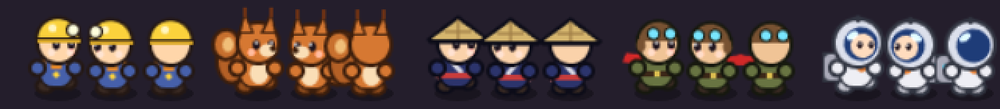

Герои нарисованы кодом в стиле «чиби»: большая голова, ножки шагают при ходьбе, ручки
качаются, взгляд следит за направлением, а со спины видно затылок. У каждого своя одежда
и шляпа: каска с фонарём, беличьи ушки и хвост, соломенная каса и катана, лётный шлем с
очками и шарфом, скафандр с ранцем. Призрак рисуется тем же героем, только
полупрозрачным и голубоватым.

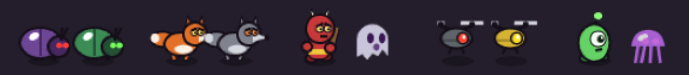

Враги в том же стиле, у каждого мира обычный и особый: жук и хитрый зелёный жук, лиса и
серый волк, красный óни с дубинкой и призрак, дрон и жёлтый разведчик, одноглазый
пришелец и медуза-телепорт. Лапки перебирают на ходу, взгляд направлен туда, куда враг
бежит, оглушённый враг сереет.

| Мир | Герой и способность (E) | Зона | Особый враг | Особенность |
|---|---|---|---|---|
| Кристальная шахта | Шахтёр, **Щит**: 4 с отбрасывает врагов | грязь замедляет | хитрый жук бежит наперерез | темнота, светит только фонарь |
| Осенний лес | Белочка, **Магнит**: 5 с собирает предметы в радиусе 2,5 клетки | лужи замедляют | волк петляет зигзагом и быстрее лисиц | золотые жёлуди: +250 очков, но исчезают через 20 с |
| Ночной храм | Ронин, **Стоп-время**: враги и ловушки замирают на 3 с | туман меняет управление на обратное | призрак телепортируется за спину (место прыжка заранее подсвечено) | проклятые души рядом с настоящими: −5 с и сброс серии |
| Руины передовой | Пилот, **Телепорт**: прыжок на 3 клетки вперёд, даже сквозь стену | масло, по нему скользишь | дрон-разведчик петляет зигзагом | мины на полу и катящиеся мины |
| Открытый космос | Космонавт, **Импульс**: оглушает врагов и разбивает астероиды рядом | невесомость, скольжение | медуза телепортируется за спину | чёрные дыры притягивают и выбрасывают на старт |

Первый мир открыт сразу, каждый следующий открывается, когда пройдены 4 уровня
предыдущего (на любой сложности). Испытание дня каждый день переходит в следующий мир,
поэтому все миры можно попробовать и без прохождения кампании.

| Выбор мира | Лес |
|---|---|
| 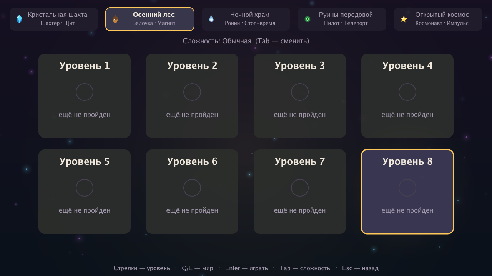 | 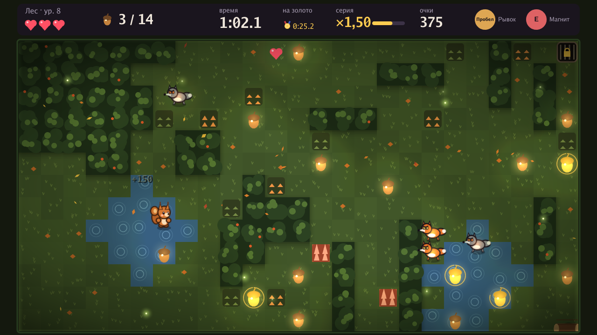 |

| Храм | Передовая |
|---|---|
| 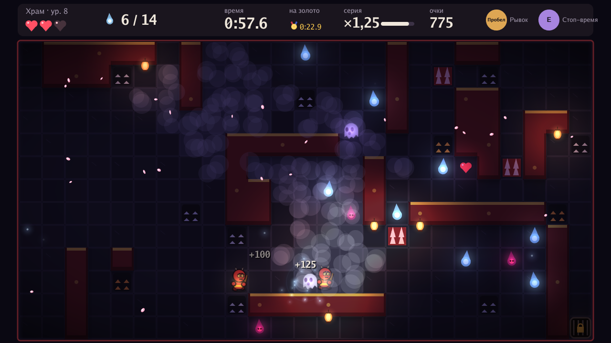 | 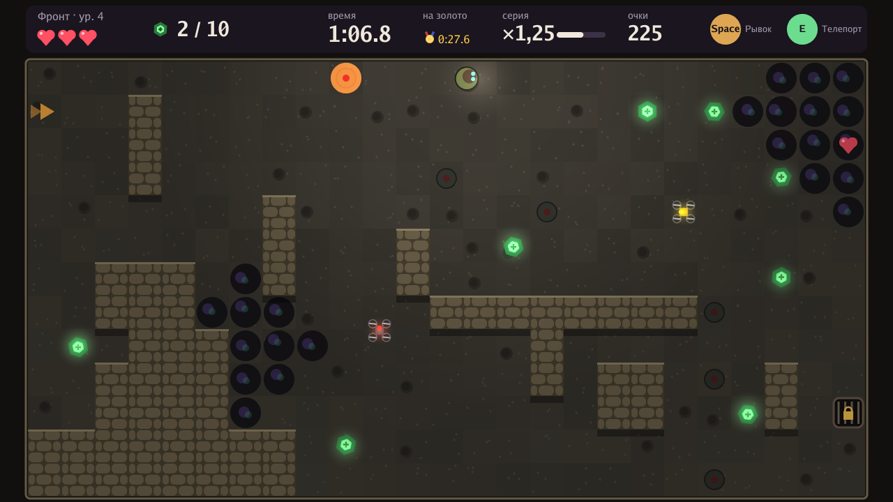 |

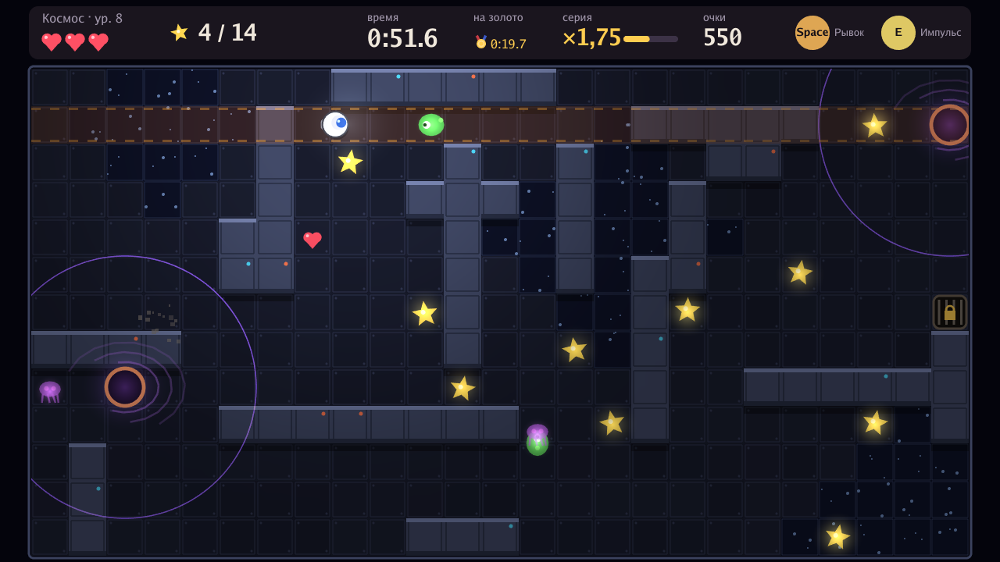

## Соревновательная часть

1. **Таблицы рекордов** для каждого уровня и сложности (топ-10, по одной строке на игрока).
   Несколько человек на одном компьютере соревнуются, меняя имя в меню.
2. **Призрак соперника.** Лучший забег на уровне проигрывается полупрозрачным шахтёром
   рядом с тобой. В интерфейсе видно, кто впереди по кристаллам, а в итогах сказано,
   на сколько очков ты обошёл призрака или отстал от него.
3. **Испытание дня.** Каждый день (по UTC) генерируется новый уровень в одном из пяти миров
   (по кругу). Он одинаковый у всех игроков, сложность всегда обычная, так что результаты
   можно честно сравнивать.
4. **Марафон.** Уровни идут подряд через все пять миров и постепенно усложняются
   (с 13-го этапа включается сложная сложность). Жизни переносятся с этапа на этап, а
   каждые 5 пройденных этапов одна возвращается. Очки складываются. Набор этапов
   меняется раз в неделю и одинаков у всех, поэтому у марафона своя таблица «Рекорды
   недели», где видно, сколько этапов прошёл каждый. Записи всех этапов сохраняются,
   и результат можно перепроверить пересимуляцией (`sim.RunMarathon`).
5. **Мгновенный рестарт (R)** для тех, кто проходит уровень на время (в марафоне его нет).
6. **Дуэль вдвоём** на одном компьютере или планшете (см. ниже).
7. **Достижения**: 21 награда, от «Первого выхода» до «Золотого мира» (золото на всех
   уровнях одного мира), два из них секретные. Получение показывается всплывающей
   плашкой, полный список с прогрессом — в меню «Достижения». Идентификаторы стабильные,
   чтобы потом один в один завести их в Steam.

| Достижения | Уведомление |
|---|---|
| 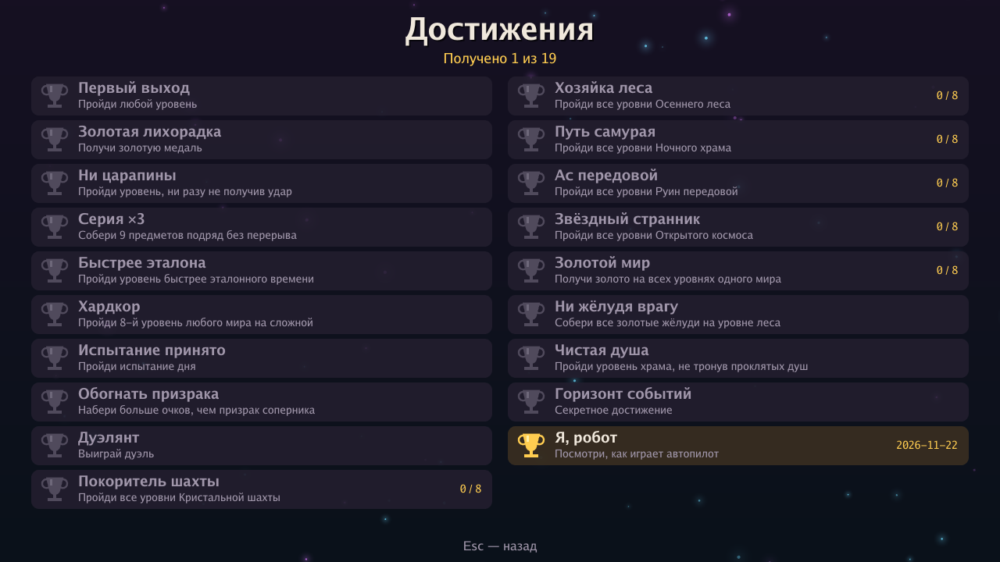 | 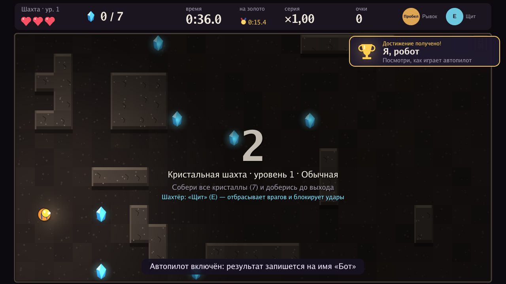 |

| Марафон | Между этапами |
|---|---|
| 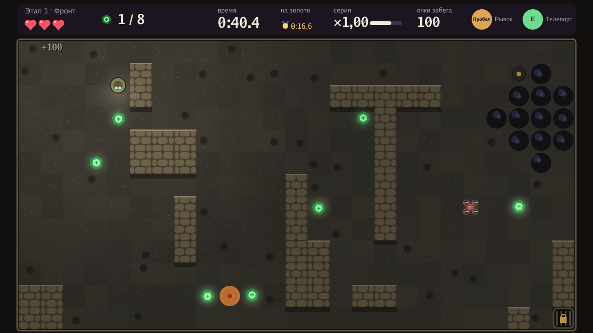 | 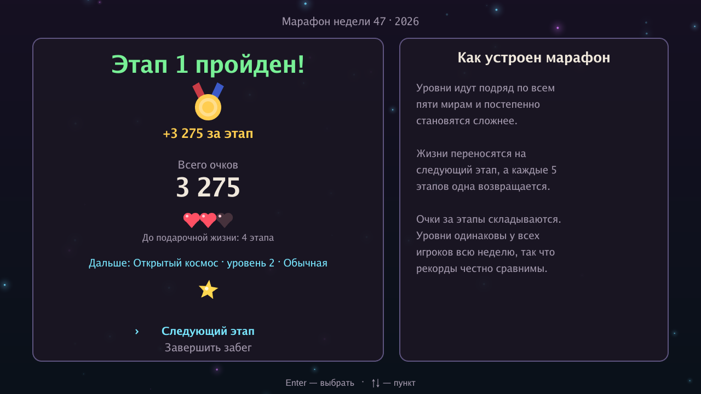 |

### Дуэль вдвоём

Двое игроков на одной карте одновременно. Предметы общие: кто первым взял, тому и очки,
серии работают как обычно. Рывок в соперника оглушает его, а «Стоп-время» и «Импульс»
бьют и по сопернику. Враги охотятся за ближайшим игроком. Выбитый игрок теряет 300 очков
и через 3 секунды возвращается на старт. Кто первым выйдет через открытый выход, получает
+500. Побеждает тот, у кого больше очков. Счёт матчей ведётся за сеанс. В дуэли доступны
все пять миров, без открытия по прогрессу.

| | Игрок 1 | Игрок 2 |
|---|---|---|
| Движение | W A S D | стрелки |
| Рывок | Space / левый Shift | правый Shift / Enter / L |
| Способность | E / Q | правый Ctrl / `/` / K |
| Геймпад | первый из двух | второй, или единственный |
| Планшет | левая половина экрана | правая половина экрана |

F9 в дуэли включает бота за второго игрока (можно сыграть одному), нажатие ещё раз ставит
ботов за обоих.

| Выбор дуэли | Дуэль |
|---|---|
| 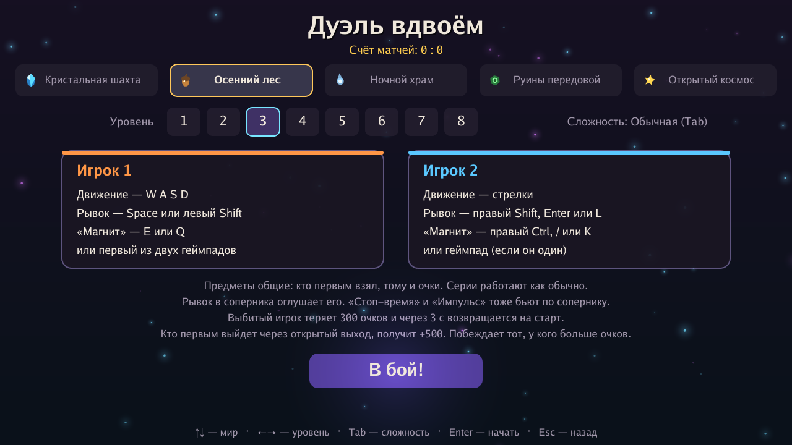 | 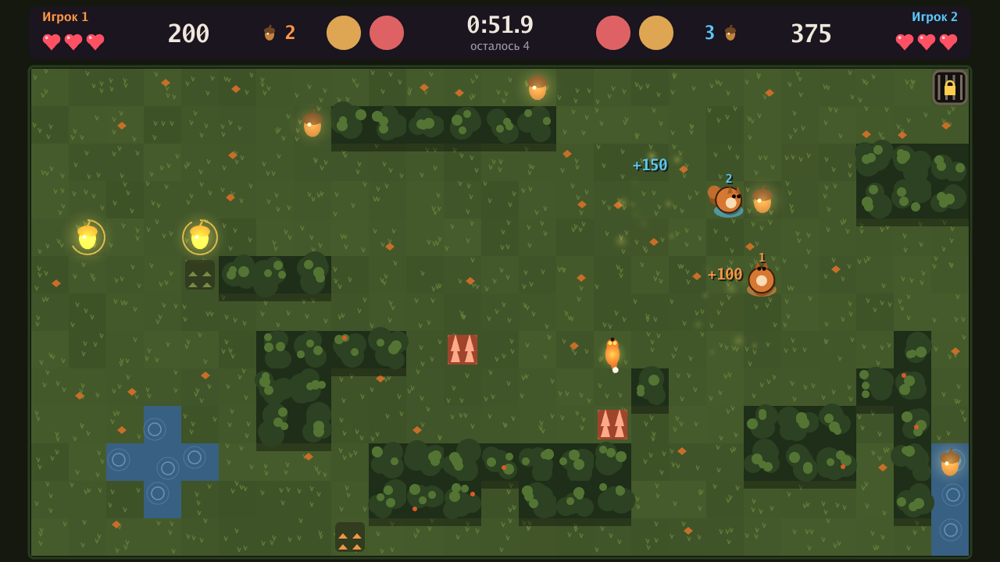 |

## Сборка и запуск

Нужен [Go 1.25+](https://go.dev/dl/). Под Windows cgo и компилятор C не нужны.

```bat
:: Windows
scripts\build-windows.bat
dist\Pyatimirye.exe
```

```sh
# Linux/macOS: кросс-сборка exe и веб-версии
./scripts/build.sh
python3 -m http.server -d dist/web 8000   # открыть http://localhost:8000
```

`dist/Pyatimirye.html` — та же веб-версия одним файлом (~6 МБ): открывается двойным
щелчком прямо с диска, без сервера и установки. Папку `dist/web` так открыть нельзя:
браузер не загружает `game.wasm` по адресу `file://`, и экран остаётся чёрным.

В exe вшиты иконка, манифест и сведения о версии (`cmd/pyatimirye/winres`, файлы
`.syso` собираются командой `go-winres make` в этой папке), а отладочные символы не
вырезаются: антивирусы реже принимают такие файлы за подозрительные.

Windows может не дать запустить `Pyatimirye.exe`, потому что у файла нет цифровой
подписи. SmartScreen пропускает его по кнопке «Подробнее» → «Выполнить в любом случае».
Если включён Smart App Control, неподписанные программы он блокирует совсем, и
остаётся играть в `Pyatimirye.html`. Для выхода в Steam exe нужно будет подписать
сертификатом разработчика.

Быстрый запуск из исходников: `go run ./cmd/pyatimirye`
(на Linux нужны пакеты `libgl1-mesa-dev xorg-dev libasound2-dev`).

Тесты: `go test ./internal/...`

Все версии собирает GitHub Actions при каждом коммите: вкладка
**Actions → build → Artifacts**. Там лежат `Pyatimirye-windows` (exe),
`Pyatimirye-linux`, `Pyatimirye-macos`, `Pyatimirye-web`, `Pyatimirye-android` (APK)
и `Pyatimirye-ios-xcframework`.

### Android

Нужны Android SDK и NDK (проще всего поставить через Android Studio) и JDK 17.

```sh
export ANDROID_HOME=~/Android/Sdk
export ANDROID_NDK_HOME=$ANDROID_HOME/ndk/<версия>
go tool ebitenmobile bind -target android -androidapi 23 \
  -javapkg com.brokendoto.pyatimirye -o android/app/libs/pyatimirye.aar ./mobile
cd android && gradle assembleDebug     # или открыть папку android в Android Studio
# APK: android/app/build/outputs/apk/debug/app-debug.apk
```

`ebitenmobile` превращает пакет `mobile/` в библиотеку `.aar` с готовым элементом
`EbitenView`. Java-часть (`android/app/src/main/java/.../MainActivity.java`) только
растягивает его на весь экран, передаёт игре папку для сохранений и ставит игру на паузу,
когда приложение свёрнуто. Отладочный APK можно сразу поставить на телефон; для Google Play
нужна подпись релизным ключом (`gradle assembleRelease` с настройками `signingConfigs`).

### iOS

На Mac с Xcode: `go tool ebitenmobile bind -target ios -o Pyatimirye.xcframework ./mobile`,
затем фреймворк добавляется в проект Xcode, а на экран кладётся `MobileEbitenViewController`.
Для установки на iPhone и публикации в App Store нужен аккаунт Apple Developer.

Сохранения лежат в `%AppData%\Pyatimirye\` (`profile.json` с прогрессом и настройками,
`records.json` с таблицами рекордов и записями забегов).

## Архитектура

```
cmd/pyatimirye/      точка входа: окно, иконка, запуск игрового цикла
cmd/storeart/        картинки для страницы Steam из скриншотов (go run ./cmd/storeart)
steam/               скрипты SteamPipe, картинки и тексты для магазина
internal/sim/        правила игры без графики: уровень, генератор, миры, шаг симуляции, очки, бот
internal/replay/     упаковка записи нажатий (RLE + base64)
internal/save/       профиль и таблицы рекордов (JSON), интерфейс Leaderboard
internal/controls/   раскладки клавиш: умолчания, переназначение без конфликтов, сохранение
internal/achieve/    достижения: список и проверка условий по итогам забега
internal/platform/   связь с магазином: заглушка и Steamworks (сборка с тегом steam)
internal/sfx/        синтез звуков в коде (синусоиды, шум, огибающие)
internal/music/      музыка: сочинение по правилам и синтез, своя пьеса у меню и каждого мира
internal/game/       сцены (меню, уровни, игра, итоги, рекорды), отрисовка миров, ввод, касания
internal/assets/     встроенные ресурсы (иконка)
mobile/              точка входа для Android и iOS (ebitenmobile)
android/             проект Android: Activity на Java, манифест, иконки, Gradle
```

Игра и правила одни и те же на всех платформах: различается только точка входа
(`cmd/pyatimirye` для компьютера и браузера, `mobile` для телефонов) и способ ввода.
Касания превращаются в ту же 6-битную маску `sim.Input`, что и клавиатура, поэтому
рекорды, повторы и призраки работают одинаково везде.

```
 клавиатура/геймпад ──► game.readPlayInput ──► sim.Input (6 бит)
                                                  │
                         ┌────────────────────────┤ запись в []Input
                         ▼                        ▼
               sim.State.Step()  ×60/с      replay.Encode ──► save.Records (JSON)
                         │                                         │
                  события (Events)                   призрак ◄─────┘ (повтор записи)
                         ▼
            game: частицы, звук, тряска экрана
```

Главное архитектурное решение: **логика отделена от отрисовки и детерминирована**.

- Пакет `sim` не импортирует Ebitengine. Он работает фиксированными шагами 60 раз в секунду,
  и всё, что в нём происходит, зависит только от уровня и последовательности нажатий.
- Все случайности идут через собственный генератор `sim.RNG` (SplitMix64) с зерном трассы.
- Уровень строится из зерна, поэтому его не нужно хранить: ключа трассы `mine-03-normal`
  достаточно, чтобы у всех игроков получилась одна и та же карта.
- Отсюда бесплатно получаются **повторы**: забег хранится как список нажатий (обычно меньше
  1 КБ), а призрак — это вторая копия симуляции, которой подаются записанные нажатия.
- Отсюда же **проверка рекордов**: перед показом призрака игра заново проигрывает запись
  и сверяет счёт с таблицей. Для онлайн-таблиц Steam это основа защиты от накруток:
  сервер (или другой клиент) может перепроверить любой результат.
- События шага (`EvPickup`, `EvHit`, …) нужны только графике и звуку и на исход не влияют.

## Алгоритмы

- **Музыка** (`music/`): пьесы не записаны нотами, а сочиняются по правилам из зерна. У
  каждого мира своя гамма (дорийская для шахты, миксолидийская для леса, японская
  пентатоника хирадзёси для храма, минор для передовой, лидийская для космоса), темп,
  последовательность аккордов, рисунок баса и барабанов и набор тембров (кото, флейта,
  колокольчик, 8-битный квадрат, пэд). Мелодия строится из двух мотивов по форме
  A A′ B A, держится рядом с аккордом и заканчивает фразу на его тонике. Звук синтезируется
  сложением гармоник с огибающими, хвосты нот заворачиваются в начало, поэтому 16 тактов
  крутятся по кругу без шва. Пьеса синтезируется в фоне за долю секунды при первом
  запросе, смена мира — плавный переход за полсекунды.
- **Генерация уровня** (`sim/gen.go`): на поле 25×13 ставятся случайные скальные блоки,
  затем поиском в ширину (BFS) от старта всё недостижимое засыпается породой. Если
  свободных клеток меньше 55%, попытка отбрасывается. Выход ставится в самую дальнюю
  по пути клетку у правого края, кристаллы раскладываются не ближе 2 клеток друг к другу.
- **Преследование** (`sim/state.go`): каждый шаг строится поле расстояний BFS от клетки игрока.
  Жук идёт от центра клетки к центру соседней клетки с меньшим расстоянием (градиентный спуск
  по полю расстояний). «Хитрый» жук использует поле от точки в 3 клетках перед игроком.
- **Особые враги**: зигзаг с вероятностью 40% на развилке сворачивает не туда, зато бежит
  на 20% быстрее; призрак раз в 5 с выбирает клетку в 2–3 шагах за спиной игрока,
  0,75 с подсвечивает её и прыгает туда.
- **Дуэль** (`sim/duel.go`): оба игрока живут в том же `State`, что и одиночная игра. В каждый
  момент в нём «загружен» один игрок, а проверки опасностей перебирают обоих через
  `eachPlayer`. Враги идут по полю расстояний, построенному поиском в ширину сразу от двух
  клеток (`BFSMulti`), поэтому каждый бежит к ближайшему игроку. В одиночной игре эти
  функции ничего не меняют, так что старые записи и призраки работают как раньше.
- **Миры как данные** (`sim/worlds.go`): таблица `WorldRules` задаёт для мира зону, способность,
  особого врага и набор ловушек. Генератор и симуляция читают её, а не проверяют мир в коде,
  поэтому новый мир добавляется строкой в таблице и функциями отрисовки в `game/themes.go`.
- **Эталонное время**: жадный обход «к ближайшему кристаллу» по кратчайшим путям, потом
  к выходу. Это эвристика для задачи коммивояжёра, её достаточно для медалей.
- **Движение**: оси двигаются по отдельности, упор в стену находится бинарным поиском,
  на углах игрока мягко подталкивает к центру прохода, чтобы не цепляться за клетки.
- **Сжатие записи**: RLE по парам (кнопки, длина серии в varint), затем base64.

## Тесты

`go test ./internal/...` проверяет:

- генерация детерминирована, все предметы и выход достижимы (120 трасс кампании: 5 миров ×
  8 уровней × 3 сложности, и 28 дней испытания);
- бот (`sim.Autopilot`) проходит каждый уровень без опасностей и укладывается в золото
  (в храме, где туман путает управление, хотя бы в серебро), то есть игрок нигде
  не застревает и эталон посчитан правильно;
- повтор записи даёт ровно тот же результат, что и живая игра;
- опасности действительно наносят урон, случайные нажатия не ломают симуляцию;
- миры открываются по прогрессу, а испытание дня кампанию не продвигает;
- достижения: настоящий забег бота даёт «Первый выход», «Ни царапины», «Хардкор» и золото,
  забег с автопилотом даёт только «Я, робот», прогресс миров считается по всем сложностям,
  повторно достижение не выдаётся;
- раскладки клавиш: у умолчаний нет пустых действий и общих клавиш у игроков дуэли,
  переназначение снимает клавишу со старого действия, раскладки сохраняются и читаются;
- дуэль детерминирована, два бота делят все предметы и доходят до выхода, рывок оглушает
  соперника, выбитый игрок возвращается, а не проигрывает;
- таблица рекордов сортирует, ограничивает размер и сохраняется на диск;
- музыка: каждая пьеса звучит, не перегружена, синтезируется одинаково, все ноты в гамме;
- марафон: этапы проходят все миры, уровень не убывает, сложная сложность с 13-го этапа,
  жизнь возвращается каждые 5 этапов, повтор записей этапов даёт тот же итог, что живая игра;
- упаковка повторов работает в обе стороны и отвергает испорченные данные;
- идентификаторы достижений годятся как API-имена Steam, а без Steam игра работает на заглушке.

## Почему Go + Ebitengine

- Оригинальная игра была написана на Go, так что это её прямое продолжение.
- [Ebitengine](https://ebitengine.org) — зрелый 2D-движок на Go; на нём выпущены коммерческие
  игры в Steam и на Nintendo Switch.
- Под Windows собирается без cgo одной командой, в том числе кросс-компиляцией из Linux.
- Масштабирование под любое разрешение до 4K, полный экран и геймпады (включая Steam Deck)
  есть из коробки.
- Steamworks подключён через [go-steamworks](https://github.com/hajimehoshi/go-steamworks)
  (сборка с тегом `steam`, см. [docs/STEAM.md](docs/STEAM.md)): достижения Steam, имя
  игрока и статус для друзей. Онлайн-таблицы встанут за интерфейс `save.Leaderboard`,
  когда библиотека научится работать с leaderboards.

## План

- [x] Ядро: шахта, 8 уровней, 3 сложности, опасности, способности
- [x] Таблицы рекордов, призрак, испытание дня, проверка записей
- [x] Остальные четыре мира со своими героями и способностями (лес, храм, передовая, космос)
- [x] Кросс-платформенность: Windows, Linux, macOS, браузер, Android, iOS; сенсорное управление
- [x] Дуэль вдвоём на одном экране (WASD против стрелок, два геймпада, планшет)
- [x] Настройки: переназначение клавиш, громкость, тряска экрана
- [x] Достижения (21 штука, экран со списком и прогрессом)
- [x] Марафон: бесконечная череда уровней, рекорды недели
- [x] Музыка: своя пьеса у меню и каждого мира, громкость музыки в настройках
- [x] Новые модельки героев и врагов (чиби, анимация шагов, свои костюмы)
- [x] Steamworks: достижения Steam, имя и статус игрока, сборки Windows и Linux/Steam Deck,
  скрипты SteamPipe, картинки и тексты для магазина ([docs/STEAM.md](docs/STEAM.md))
- [ ] Онлайн-таблицы рекордов Steam (нужна поддержка leaderboards в go-steamworks)
- [ ] Публикация: Google Play (подпись релиза), App Store, веб-версия на GitHub Pages

## Лицензии

Код, графика, звуки и музыка игры созданы в коде проекта и принадлежат автору: чужих
картинок, сэмплов и мелодий в игре нет. Шрифты Go (BSD), Ebitengine (Apache 2.0).
