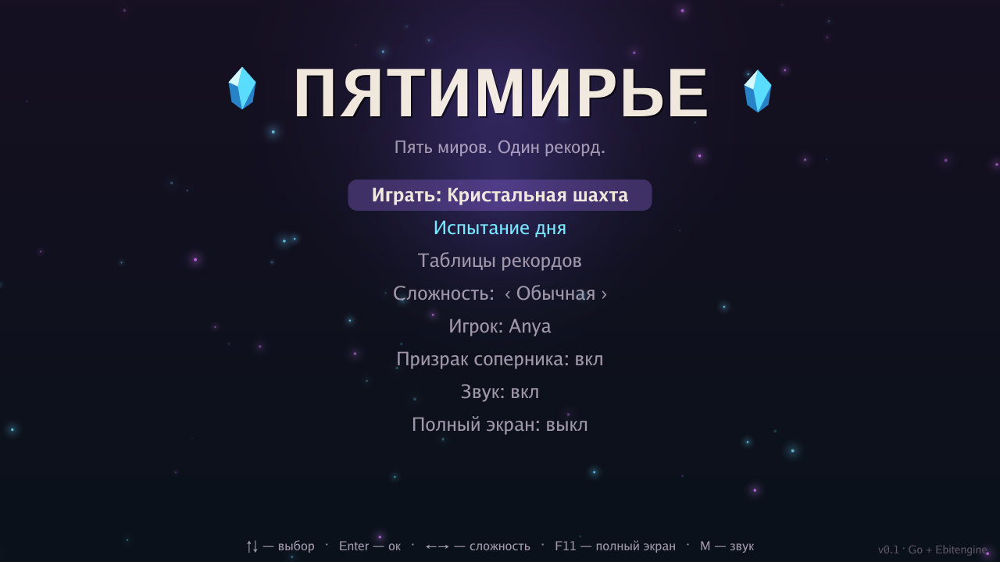
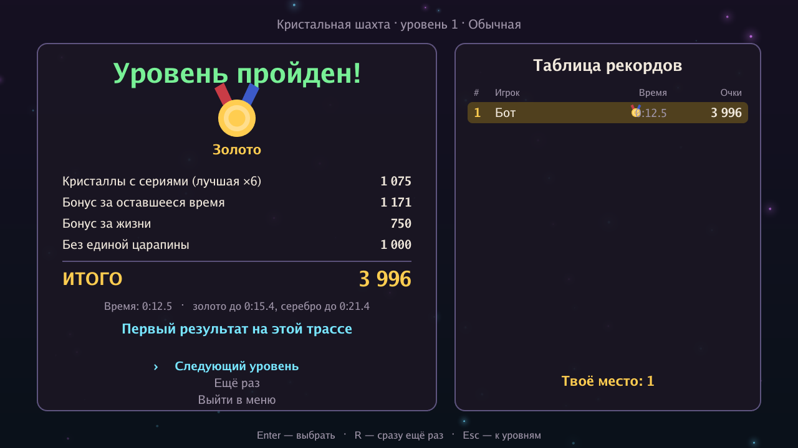
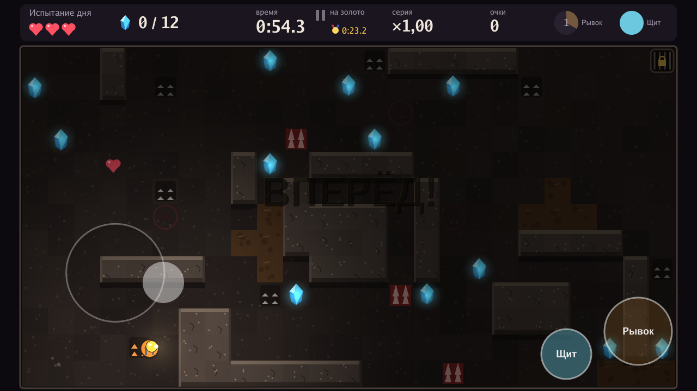
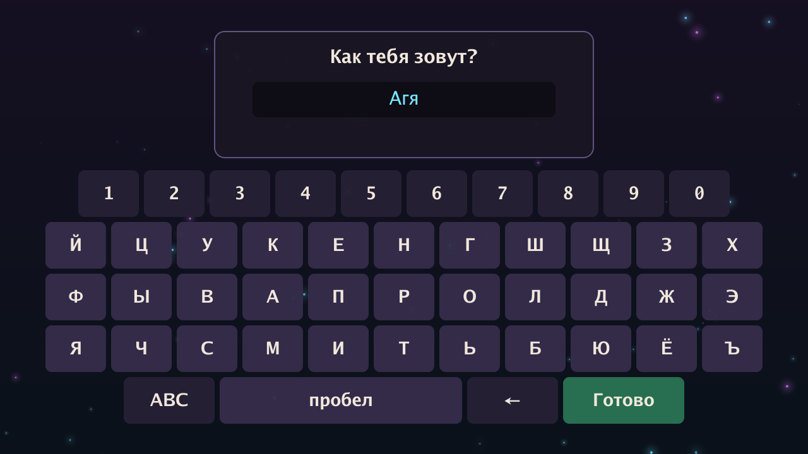

# Пятимирье

Аркада на время: собери все предметы, не попадись врагам и ловушкам, добеги до выхода.
Главное в игре соревнование: таблицы рекордов на каждом уровне, призрак лучшего забега,
который бежит рядом с тобой, и испытание дня с одинаковым для всех уровнем.

Пять миров: **Кристальная шахта** (готова), Осенний лес, Ночной храм, Руины передовой,
Открытый космос (в разработке).


| Меню | Итоги уровня |
|---|---|
|  |  |

**Платформы:** Windows, Linux, macOS, Android, iOS и браузер (WebAssembly).

## Как играть

| Действие | Клавиатура | Геймпад |
|---|---|---|
| Движение | WASD / стрелки | левый стик / крестовина |
| Рывок (неуязвим на время рывка) | Space / Shift | A / RB |
| Щит (отбрасывает врагов, 4 с) | E / Q | X / LB |
| Пауза | Esc / P | Start |
| Мгновенный рестарт | R | Y |
| Полный экран | F11 / Alt+Enter | |
| Звук | M | |
| Автопилот (демонстрация, F9) | F9 | |

**На телефоне** управление сенсорное: левая половина экрана — плавающий джойстик
(касаешься где угодно и ведёшь пальцем), справа кнопки «Рывок» и «Щит», касание верхней
панели ставит на паузу. Меню нажимаются пальцем, имя вводится на экранной клавиатуре
(русская и латинская раскладки). Экранные кнопки появляются и на компьютере с
сенсорным экраном, а пункты меню можно нажимать мышью.

| Телефон: игра | Телефон: ввод имени |
|---|---|
|  |  |

**Очки.** Каждый кристалл стоит 100 очков, умноженных на серию: если брать кристаллы
не дольше чем через 2,5 с друг за другом, множитель растёт до ×3. В конце добавляются
бонусы за оставшееся время, жизни и прохождение без единого попадания.

**Медали.** Для каждого уровня считается эталонное время (см. «Алгоритмы»). Золото
можно получить, уложившись в 115% эталона, серебро в 160%, бронзу дают за прохождение.

**Опасности шахты** появляются постепенно, по одной на уровень:

- грязь замедляет и игрока, и жуков;
- шипы выдвигаются по таймеру, перед этим вспыхивают оранжевым;
- глубинные жуки ищут кратчайший путь к игроку, а «хитрый» зелёный жук бежит наперерез;
- валуны катятся по строке или столбцу, о них заранее предупреждает мигающая стрелка;
- обвалы засыпают целую строку или столбец, перед этим полоса мигает пунктиром.

## Соревновательная часть

1. **Таблицы рекордов** для каждого уровня и сложности (топ-10, по одной строке на игрока).
   Несколько человек на одном компьютере соревнуются, меняя имя в меню.
2. **Призрак соперника.** Лучший забег на уровне проигрывается полупрозрачным шахтёром
   рядом с тобой. В интерфейсе видно, кто впереди по кристаллам, а в итогах сказано,
   на сколько очков ты обошёл призрака или отстал от него.
3. **Испытание дня.** Каждый день (по UTC) генерируется новый уровень. Он одинаковый у всех
   игроков, сложность всегда обычная, так что результаты можно честно сравнивать.
4. **Мгновенный рестарт (R)** для тех, кто проходит уровень на время.

## Сборка и запуск

Нужен [Go 1.25+](https://go.dev/dl/). Под Windows cgo и компилятор C не нужны.

```bat
:: Windows
scripts\build-windows.bat
dist\Pyatimirye.exe
```

```sh
# Linux/macOS: кросс-сборка exe и веб-версии
./scripts/build.sh
python3 -m http.server -d dist/web 8000   # открыть http://localhost:8000
```

Быстрый запуск из исходников: `go run ./cmd/pyatimirye`
(на Linux нужны пакеты `libgl1-mesa-dev xorg-dev libasound2-dev`).

Тесты: `go test ./internal/...`

Все версии собирает GitHub Actions при каждом коммите: вкладка
**Actions → build → Artifacts**. Там лежат `Pyatimirye-windows` (exe),
`Pyatimirye-linux`, `Pyatimirye-macos`, `Pyatimirye-web`, `Pyatimirye-android` (APK)
и `Pyatimirye-ios-xcframework`.

### Android

Нужны Android SDK и NDK (проще всего поставить через Android Studio) и JDK 17.

```sh
export ANDROID_HOME=~/Android/Sdk
export ANDROID_NDK_HOME=$ANDROID_HOME/ndk/<версия>
go tool ebitenmobile bind -target android -androidapi 23 \
  -javapkg com.brokendoto.pyatimirye -o android/app/libs/pyatimirye.aar ./mobile
cd android && gradle assembleDebug     # или открыть папку android в Android Studio
# APK: android/app/build/outputs/apk/debug/app-debug.apk
```

`ebitenmobile` превращает пакет `mobile/` в библиотеку `.aar` с готовым элементом
`EbitenView`. Java-часть (`android/app/src/main/java/.../MainActivity.java`) только
растягивает его на весь экран, передаёт игре папку для сохранений и ставит игру на паузу,
когда приложение свёрнуто. Отладочный APK можно сразу поставить на телефон; для Google Play
нужна подпись релизным ключом (`gradle assembleRelease` с настройками `signingConfigs`).

### iOS

На Mac с Xcode: `go tool ebitenmobile bind -target ios -o Pyatimirye.xcframework ./mobile`,
затем фреймворк добавляется в проект Xcode, а на экран кладётся `MobileEbitenViewController`.
Для установки на iPhone и публикации в App Store нужен аккаунт Apple Developer.

Сохранения лежат в `%AppData%\Pyatimirye\` (`profile.json` с прогрессом и настройками,
`records.json` с таблицами рекордов и записями забегов).

## Архитектура

```
cmd/pyatimirye/      точка входа: окно, иконка, запуск игрового цикла
internal/sim/        правила игры без графики: уровень, генератор, шаг симуляции, очки, бот
internal/replay/     упаковка записи нажатий (RLE + base64)
internal/save/       профиль и таблицы рекордов (JSON), интерфейс Leaderboard
internal/sfx/        синтез звуков в коде (синусоиды, шум, огибающие)
internal/game/       сцены (меню, уровни, игра, итоги, рекорды), отрисовка, ввод, касания
internal/assets/     встроенные ресурсы (иконка)
mobile/              точка входа для Android и iOS (ebitenmobile)
android/             проект Android: Activity на Java, манифест, иконки, Gradle
```

Игра и правила одни и те же на всех платформах: различается только точка входа
(`cmd/pyatimirye` для компьютера и браузера, `mobile` для телефонов) и способ ввода.
Касания превращаются в ту же 6-битную маску `sim.Input`, что и клавиатура, поэтому
рекорды, повторы и призраки работают одинаково везде.

```
 клавиатура/геймпад ──► game.readPlayInput ──► sim.Input (6 бит)
                                                  │
                         ┌────────────────────────┤ запись в []Input
                         ▼                        ▼
               sim.State.Step()  ×60/с      replay.Encode ──► save.Records (JSON)
                         │                                         │
                  события (Events)                   призрак ◄─────┘ (повтор записи)
                         ▼
            game: частицы, звук, тряска экрана
```

Главное архитектурное решение: **логика отделена от отрисовки и детерминирована**.

- Пакет `sim` не импортирует Ebitengine. Он работает фиксированными шагами 60 раз в секунду,
  и всё, что в нём происходит, зависит только от уровня и последовательности нажатий.
- Все случайности идут через собственный генератор `sim.RNG` (SplitMix64) с зерном трассы.
- Уровень строится из зерна, поэтому его не нужно хранить: ключа трассы `mine-03-normal`
  достаточно, чтобы у всех игроков получилась одна и та же карта.
- Отсюда бесплатно получаются **повторы**: забег хранится как список нажатий (обычно меньше
  1 КБ), а призрак — это вторая копия симуляции, которой подаются записанные нажатия.
- Отсюда же **проверка рекордов**: перед показом призрака игра заново проигрывает запись
  и сверяет счёт с таблицей. Для онлайн-таблиц Steam это основа защиты от накруток:
  сервер (или другой клиент) может перепроверить любой результат.
- События шага (`EvPickup`, `EvHit`, …) нужны только графике и звуку и на исход не влияют.

## Алгоритмы

- **Генерация уровня** (`sim/gen.go`): на поле 25×13 ставятся случайные скальные блоки,
  затем поиском в ширину (BFS) от старта всё недостижимое засыпается породой. Если
  свободных клеток меньше 55%, попытка отбрасывается. Выход ставится в самую дальнюю
  по пути клетку у правого края, кристаллы раскладываются не ближе 2 клеток друг к другу.
- **Преследование** (`sim/state.go`): каждый шаг строится поле расстояний BFS от клетки игрока.
  Жук идёт от центра клетки к центру соседней клетки с меньшим расстоянием (градиентный спуск
  по полю расстояний). «Хитрый» жук использует поле от точки в 3 клетках перед игроком.
- **Эталонное время**: жадный обход «к ближайшему кристаллу» по кратчайшим путям, потом
  к выходу. Это эвристика для задачи коммивояжёра, её достаточно для медалей.
- **Движение**: оси двигаются по отдельности, упор в стену находится бинарным поиском,
  на углах игрока мягко подталкивает к центру прохода, чтобы не цепляться за клетки.
- **Сжатие записи**: RLE по парам (кнопки, длина серии в varint), затем base64.

## Тесты

`go test ./internal/...` проверяет:

- генерация детерминирована, все кристаллы и выход достижимы (24 уровня кампании и 28 дней);
- бот (`sim.Autopilot`) проходит каждый уровень без опасностей и укладывается в золото,
  то есть игрок нигде не застревает и эталон посчитан правильно;
- повтор записи даёт ровно тот же результат, что и живая игра;
- опасности действительно наносят урон;
- таблица рекордов сортирует, ограничивает размер и сохраняется на диск;
- упаковка повторов работает в обе стороны и отвергает испорченные данные.

## Почему Go + Ebitengine

- Оригинальная игра была написана на Go, так что это её прямое продолжение.
- [Ebitengine](https://ebitengine.org) — зрелый 2D-движок на Go; на нём выпущены коммерческие
  игры в Steam и на Nintendo Switch.
- Под Windows собирается без cgo одной командой, в том числе кросс-компиляцией из Linux.
- Масштабирование под любое разрешение до 4K, полный экран и геймпады (включая Steam Deck)
  есть из коробки.
- Steamworks (достижения, онлайн-таблицы рекордов) подключается через
  [go-steamworks](https://github.com/hajimehoshi/go-steamworks). Для этого в коде уже есть
  интерфейс `save.Leaderboard`: локальную реализацию можно заменить на Steam,
  не трогая остальную игру.

## План

- [x] Ядро: шахта, 8 уровней, 3 сложности, опасности, способности
- [x] Таблицы рекордов, призрак, испытание дня, проверка записей
- [ ] Остальные четыре мира со своими героями и способностями (лес, храм, передовая, космос)
- [x] Кросс-платформенность: Windows, Linux, macOS, браузер, Android, iOS; сенсорное управление
- [ ] Дуэль вдвоём на одном экране (WASD против стрелок)
- [ ] Переназначение клавиш, настройки графики, достижения
- [ ] Steamworks: достижения и онлайн-таблицы, сборка для Steam Deck (Linux)
- [ ] Публикация: Google Play (подпись релиза), App Store, веб-версия на GitHub Pages

## Лицензии

Код игры принадлежит автору. Шрифты Go (BSD), Ebitengine (Apache 2.0).
